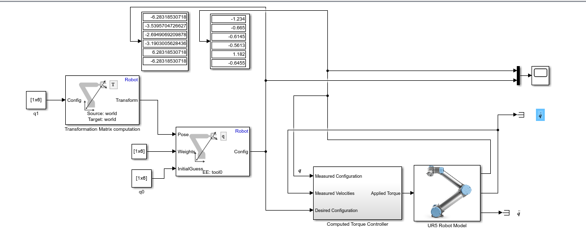
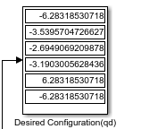
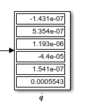
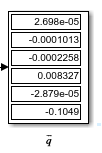
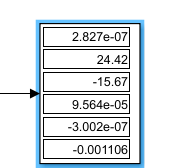

# 🦾 UR5 Robot Manipulator Project

Modeling, simulation and control of a 6-degree-of-freedom UR5 robotic manipulator arm.

---

## 📌 Table of Contents
1. [Introduction](#1-introduction)
2. [Project Objectives](#2-project-objectives)
3. [Theoretical Study](#3-theoretical-study)
   - [3.1. Robot Description and Mechanical Structure](#31-robot-description-and-mechanical-structure)
   - [3.2. Kinematic Modeling](#32-kinematic-modeling)
     - [A. Denavit-Hartenberg (DH) Parameters](#a-denavit-hartenberg-dh-parameters)
     - [B. Forward Kinematic Model (FKM)](#b-forward-kinematic-model-fkm)
     - [C. Inverse Kinematic Model (IKM)](#c-inverse-kinematic-model-ikm)
   - [3.3. Workspace and Singularity Analysis](#33-workspace-and-singularity-analysis)
     - [A. Workspace Definition](#a-workspace-definition)
     - [B. Singularity Analysis](#b-singularity-analysis)
   - [3.4. Dynamic Modeling](#34-dynamic-modeling)
     - [A. Fundamental Equation (Lagrange Formalism)](#a-fundamental-equation-lagrange-formalism)
     - [B. Inverse and Forward Dynamics](#b-inverse-and-forward-dynamics)
4. [Simulation](#4-simulation)
   - [4.1. Environment and Objective](#41-environment-and-objective)
   - [4.2. Model Architecture](#42-model-architecture)
   - [4.3. Operating Principle](#43-operating-principle)
   - [4.4. Simulation Steps](#44-simulation-steps)
   - [4.5. Results to Present](#45-results-to-present)
   - [4.6. Evaluation Criteria](#46-evaluation-criteria)
5. [Conclusion and Outlook](#5-conclusion-and-outlook)
   - [5.1. Conclusion](#51-conclusion)
   - [5.2. Limitations](#52-limitations)
   - [5.3. Future Work](#53-future-work)

---

## 1. Introduction

This project focuses on the modeling, simulation and control of the **UR5** robotic manipulator arm, a collaborative industrial robot with **6 degrees of freedom (6-DOF)** developed by Universal Robots.

The main objective is to understand the behavior of a robotic manipulator through an in-depth study of its **kinematics** and **dynamics**, as well as to implement a computed torque control strategy, validated by simulation in MATLAB / Simulink.

---

## 2. Project Objectives

The main objectives of this project are:
* Understand the mechanical architecture of the UR5 robot and its joints.
* Develop the forward kinematic model (FKM).
* Study the inverse kinematics problem (IKM).
* Analyze the robot's workspace and its geometric limits.
* Develop the complete dynamic model of the robot.
* Implement a suitable control strategy.
* Simulate the robot in MATLAB / Simulink.
* Rigorously analyze and evaluate the simulation results.

---

## 3. Theoretical Study

This section presents the mathematical and theoretical foundations governing the geometric, kinematic and dynamic behavior of the UR5 manipulator.

### 3.1. Robot Description and Mechanical Structure
The UR5 is a serial manipulator with **six revolute joints**. Its six degrees of freedom allow it to independently control the position and orientation of its end effector in three-dimensional space (**3** translational motions and **3** rotational motions).

### 3.2. Kinematic Modeling

#### A. Denavit-Hartenberg (DH) Parameters

The Denavit-Hartenberg convention is used to describe the geometric relationship between consecutive links of the robot using four parameters: link length (`aᵢ`), link twist (`αᵢ`), link offset (`dᵢ`) and joint angle (`θᵢ`). The elementary homogeneous transformation matrix between two consecutive links `i-1` and `i` is expressed as:

```text
        ┌                                                          ┐
        │ cos(θᵢ)   -sin(θᵢ)cos(αᵢ)    sin(θᵢ)sin(αᵢ)   aᵢ·cos(θᵢ) │
ⁱ⁻¹Tᵢ = │ sin(θᵢ)    cos(θᵢ)cos(αᵢ)   -cos(θᵢ)sin(αᵢ)   aᵢ·sin(θᵢ) │
        │    0           sin(αᵢ)           cos(αᵢ)           dᵢ    │
        │    0              0                 0              1     │
        └                                                          ┘
```

#### B. Forward Kinematic Model (FKM)
The FKM determines the position and orientation of the end effector as a function of the joint variables q = [q₁, q₂, q₃, q₄, q₅, q₆]ᵀ. The global transformation matrix is obtained by successively multiplying the individual transformation matrices:<br>
⁰T₆ = A₁ · A₂ · A₃ · A₄ · A₅ · A₆

#### C. Inverse Kinematic Model (IKM)
The IKM solves the inverse problem of finding the joint angles required to reach a desired pose (position and orientation) of the end effector. The numerical approach relies on the Jacobian matrix J(q), which relates joint velocities to Cartesian velocities (Ẋ = J(q)·q̇), using iterative methods based on the pseudo-inverse or damped least squares to ensure convergence and stability near singularities.

### 3.3. Workspace and Singularity Analysis

#### A. Workspace Definition
The workspace is the set of positions the robot's end effector can reach while respecting the mechanical and joint limits of the links:<br>
W = { P(q) ∈ ℝ³ | q ∈ Q }<br>
Where Q is the set of admissible joint configurations defined by the limits of each joint:<br>
qᵢ,ₘᵢₙ ≤ qᵢ ≤ qᵢ,ₘₐₓ

A distinction is made between:
* **The reachable workspace**: the set of all positions that can be reached with at least one joint configuration.
* **The dexterous workspace**: the set of positions where the end effector can achieve any required orientation.

#### B. Singularity Analysis
A singularity is a geometric configuration in which the Jacobian matrix J(q) loses rank (its determinant vanishes: det(J(q)) = 0).

* **Consequences**: loss of instantaneous degrees of freedom, joint velocities tending to infinity for normal Cartesian motions, and numerical instability of the inverse kinematics.

* **Main types on the UR5**:
   1. **Shoulder singularity**: the wrist center lies on the axis of joint 1.
   2. **Elbow singularity**: alignment of the upper arm and forearm (arm fully extended or folded).
   3. **Wrist singularity**: alignment of the axes of joints 4 and 6.

* **Monitoring indicator**: evaluating the condition number of the Jacobian κ(J) = σₘₐₓ / σₘᵢₙ makes it possible to detect the approach of a singular configuration.

### 3.4. Dynamic Modeling
Dynamics establishes the mathematical relationship between the applied forces/torques and the resulting motions, taking into account masses, centers of inertia and Coriolis forces.

#### A. Fundamental Equation (Lagrange Formalism)
The general equation of motion for a robot with n degrees of freedom is written as:<br>
M(q)·q̈ + C(q, q̇)·q̇ + G(q) = τ<br>
Where:

* **M(q)**: inertia matrix (symmetric and positive definite).
* **C(q, q̇)**: matrix of Coriolis and centrifugal forces.
* **G(q)**: vector of gravity torques compensating the weight of the links.
* **τ**: vector of torques applied to the joints.

#### B. Inverse and Forward Dynamics
* **Inverse dynamics**: computes the torques τ required to follow a reference (q, q̇, q̈). Very useful for control and motor sizing.
* **Forward dynamics**: computes the resulting accelerations q̈ as a function of the applied torques τ:<br>
q̈ = M(q)⁻¹ · [ τ - C(q, q̇)·q̇ - G(q) ]

---
## 4. Simulation

### 4.1. Environment and Objective

The simulation is carried out in **MATLAB / Simulink** with the **Robotics System Toolbox** and **Simscape Multibody**. It covers two aspects of the UR5 robot:

* **kinematics**: computing the end-effector pose (FKM), then returning to the joint angles (IKM);
* **dynamics**: computed torque control and the robot's response to the applied torques.


*Figure 4.1: Simulink model (UR5 kinematics and dynamics)*

### 4.2. Model Architecture

The model consists of two parts connected in a chain.

**Part 1: Kinematics**

| Block | Role |
|---|---|
| **q1** (1×6 constant) | Starting joint configuration to be tested |
| **Transformation Matrix computation** | FKM: computes the transformation matrix ⁰T₆ from q1 |
| **q0** (1×6 constant) | Initial guess for the IKM solver |
| **Weights** (1×6 constant) | Orientation and position weights in the IKM |
| **Inverse Kinematics** (EE: tool0) | IKM: recovers the desired joint configuration $q_d$ from the pose |

**Part 2: Dynamics and Control**

| Block | Role |
|---|---|
| **Computed Torque Controller** | Computes the torques to apply |
| **UR5 Robot Model** | Forward dynamics of the robot |
| **Scope** | Compares desired and measured signals |
| **Outputs $\dot q$ and $\ddot q$** | Joint velocities and accelerations of the robot |

*Controller inputs:*
* *Desired Configuration*: $q_d$ provided by the IKM;
* *Measured Configuration*: $q$ measured on the robot;
* *Measured Velocities*: $\dot q$ measured on the robot.

*Controller output:* *Applied Torque* $\tau$, sent to the robot.

### 4.3. Operating Principle

1. **FKM**: the configuration q1 is converted into a Cartesian end-effector pose:
   $${}^0T_6 = A_1 A_2 A_3 A_4 A_5 A_6$$
2. **IKM**: this pose is passed to the solver, which recovers the desired configuration $q_d$ starting from q0:
   $$FK(q_d) \approx {}^0T_6$$
3. **Control**: the controller compares $q_d$ to the measured configuration $q$ and computes the torques:
   $$\tau = M(q)\,v + C(q,\dot q)\dot q + G(q)$$
   $$v = \ddot q_d + K_d(\dot q_d - \dot q) + K_p(q_d - q)$$
4. **Dynamics**: the robot applies the torques $\tau$ and returns $q$, $\dot q$ and $\ddot q$:
   $$\ddot q = M(q)^{-1}\left[\tau - C(q,\dot q)\dot q - G(q)\right]$$
5. **Feedback loop**: $q$ and $\dot q$ are fed back to the controller, closing the loop.

### 4.4. Simulation Steps

**Step 1: Define the robot model.** Load the UR5 and assign it to the kinematics blocks:
```matlab
robot = loadrobot("universalUR5", DataFormat="row");
```

**Step 2: Configure the kinematics blocks.**
* In *Transformation Matrix computation*: choose the target body `tool0` (the block is currently set to *Target: world*, which always yields the identity).
* In *Inverse Kinematics*: check the end effector `tool0` and enter the weights.

**Step 3: Define the constants.**
```matlab
q0 = zeros(1,6);                          % initial guess
q1 = [pi/4 -pi/3 pi/4 -pi/4 pi/3 0];      % configuration to reach
weights = [1 1 1 1 1 1];         % [orientation position]
```

**Step 4: Tune the controller.** Choose the gains $K_p$ and $K_d$ of the *Computed Torque Controller*, then set the simulation time and the solver step size.

**Step 5: Validate the kinematics.** Check that the FKM is correct (for q = 0: P = [-0.81725 ; -0.19145 ; -0.005491] m), then that the IKM returns a consistent pose: $FK(q_d) \approx FK(q1)$.

**Step 6: Run the simulation.** Run the model and observe the robot's motion.

**Step 7: Record the signals.** Retrieve $q_d$, $q$, $\dot q$, $\ddot q$ and $\tau$ (Scope, *To Workspace* or model outputs).

**Step 8: Plot and analyze.** Display the curves described in 4.5 and compute the performance indicators from 4.6.

### 4.5. Results to Present

* **Figure 4.2**: desired configuration $q_d$ (IKM output) and measured configuration $q$<br>

* **Figure 4.3**: joint velocities $\dot q$<br>

* **Figure 4.4**: joint accelerations $\ddot q$<br>

* **Figure 4.5**: applied torques $\tau$

### 4.6. Evaluation Criteria

| Indicator | Description |
|---|---|
| IKM error | Difference between the obtained pose $FK(q_d)$ and the requested pose |
| Tracking error | $e_i(t) = q_{d,i}(t) - q_i(t)$ |
| RMSE | $\sqrt{\frac{1}{N}\sum_{k=1}^{N} e_i(k)^2}$ |
| Response time | Time to reach and remain within the error band |
| Overshoot | Maximum deviation beyond the final position |
| Maximum torque | To be compared with the UR5 motor limits |


---

## 5. Conclusion and Outlook

### 5.1. Conclusion

This project dealt with the modeling, simulation and control of the **UR5** manipulator arm, a six-degree-of-freedom robot. The study was organized around two axes: kinematics and dynamics.

On the **kinematic** side, the Denavit-Hartenberg parameters were used to establish the forward model (FKM) linking joint angles to the end-effector pose. The inverse model (IKM), solved numerically from the Jacobian, makes it possible to recover the joint configuration corresponding to a desired pose. The analysis of the workspace and singularities showed the robot's geometric limits and the configurations to avoid (shoulder, elbow and wrist), where the Jacobian loses rank.

On the **dynamic** side, the Lagrange formalism led to the equation of motion $M(q)\ddot q + C(q,\dot q)\dot q + G(q) = \tau$, which relates joint torques to the robot's motion. It serves as the basis for inverse dynamics and forward dynamics.

The **simulation** in MATLAB / Simulink made it possible to implement the whole chain: pose computation by the FKM, determination of the desired configuration by the IKM, then **computed torque** control, which compensates for inertia, Coriolis effects and gravity. [The results show that the measured positions follow the desired configuration with a small tracking error, and that the velocities, accelerations and torques remain within consistent values.]

This work allowed me to connect robotics theory (kinematics, dynamics, control) to its concrete implementation in a simulation environment.

### 5.2. Limitations

* The simulation relies on an ideal model: joint friction, sensor noise and uncertainties in the dynamic parameters are not taken into account.
* Computed torque control assumes an accurate dynamic model; its performance would degrade on a real robot whose parameters are poorly known.
* The gains $K_p$ and $K_d$ were tuned for the simulation and have not been validated on the physical robot.
* The computed torques must be compared with the actual actuator limits before any use on hardware.

### 5.3. Future Work

* **Trajectory planning**: generate joint-space trajectories (cubic or quintic polynomials) and Cartesian trajectories (straight lines) for smoother motion.
* **Pick and Place application**: use the IKM and trajectory planning to simulate a complete manipulation task with a gripper.
* **Robust or adaptive control**: account for uncertainties and disturbances, for example with an adaptive or sliding-mode controller.
* **Singularity and obstacle avoidance**: integrate monitoring of the condition number $\kappa(J)$ and collision detection.
* **Experimental validation**: test the control on a real UR5 robot or in a simulator such as Gazebo / ROS.
